# NEXORA — Phase 02 technical architecture

**Status:** proposal for approval · Phase 02 preparation
**Scope:** the engineering architecture that turns the approved product design and the Master
Specification into something buildable.
**Not in scope:** application code, migrations, running services, real provider integrations.

---

## 0. How to read this document

The Master Specification (§13–§25) already fixes a great deal: modular monolith with DDD layering,
the base stack, multi-tenancy by `workspace_id`, RBAC+ABAC, AI Gateway, Agent/Workflow engines,
usage ledger, the security baseline. **None of that is re-opened here.** Re-proposing settled
decisions is how architecture documents waste a reviewer's time.

Three statuses are used, and they are not interchangeable:

| Status | Meaning |
|---|---|
| **[S]** | Stated in the Master Specification. This document only explains how it will be built. |
| **[D]** | **Design decision proposed here.** The specification leaves the detail open; this is a concrete recommendation that needs approval. |
| **[P]** | **Parameter.** Depends on market, contract, budget or law. Left configurable on purpose. |

Every section ends with the trade-off the decision buys, not just the decision.

---

## 1. The architectural stance in one page

```
┌──────────────────────────────────────────────────────────────────────┐
│  Browser                                                             │
│  Next.js (app router) · design tokens · server components by default │
└───────────────┬──────────────────────────────────────────────────────┘
                │ HTTPS · session cookie (HttpOnly) or OAuth bearer
┌───────────────▼──────────────────────────────────────────────────────┐
│  Edge / API Gateway                                                  │
│  TLS · WAF · rate limit · request id · authn hand-off                │
└───────────────┬──────────────────────────────────────────────────────┘
                │
┌───────────────▼──────────────────────────────────────────────────────┐
│  API (NestJS modular monolith)                                       │
│  ┌────────────┬────────────┬────────────┬────────────┬────────────┐  │
│  │ Identity   │ Workspace  │ AI Platform│ Agent      │ Knowledge  │  │
│  │ & Access   │ & Org      │            │ Engine     │ & Files    │  │
│  ├────────────┼────────────┼────────────┼────────────┼────────────┤  │
│  │ Workflow   │ API & Dev  │ Marketplace│ Billing &  │ Notification│ │
│  │ Engine     │ Platform   │            │ Entitlement│            │ │
│  └────────────┴────────────┴────────────┴────────────┴────────────┘  │
│  Policy Engine · Audit · Outbox · Tenant Context (cross-cutting)     │
└──┬──────────────┬──────────────┬──────────────┬──────────────────────┘
   │              │              │              │
┌──▼────┐   ┌─────▼─────┐  ┌─────▼─────┐  ┌─────▼──────┐
│Postgres│   │  Redis    │  │ S3-compat │  │ AI Gateway │──► providers
│+ RLS   │   │cache/queue│  │  storage  │  │ (egress)   │
└────────┘   └───────────┘  └───────────┘  └────────────┘
```

Three properties drive every decision below:

1. **Tenant isolation is a property of the request, not of the query.** A request carries a tenant
   context; every layer that touches data receives it. There is no code path where "which workspace"
   is inferred.
2. **The AI is a client of the platform, not a peer.** It calls the same authorised APIs a user
   could call, with the user's permissions, and stops at the same approval gates.
3. **Every irreversible action has a durable record before it happens.** Approval, billing, deletion
   and provider egress are recorded first, executed second.

---

## 2. Application architecture

**[S]** Modular monolith, one deployable API, workers as a separate process from the same codebase.

**[D-ARCH-01] Four deployables, one repository.**

| Deployable | Responsibility | Scaling unit |
|---|---|---|
| `web` | Next.js UI, server components, BFF calls to the API | stateless, CDN + node |
| `api` | HTTP surface, all modules, synchronous work | stateless, horizontal |
| `worker` | Outbox relay, workflow steps, agent runs, AI streaming jobs, email, webhooks | stateless, queue-driven |
| `scheduler` | Cron-like triggers, retention sweeps, usage roll-ups | single leader via Postgres advisory lock |

**Why.** Synchronous request latency and background throughput have different scaling curves and
different failure modes. Separating them at deploy time costs one Dockerfile; separating them later
costs a refactor. Keeping them in one repository keeps the module contracts honest.

**Alternatives considered.**
- *Single process for everything* — an AI streaming job or a 10-minute workflow step would compete
  with API latency; a memory leak in a worker takes the product down.
- *Full microservices now* — explicitly rejected by §13.1 of the specification, and correctly so:
  the domain boundaries are not yet proven by load.

**Security.** Worker and scheduler run with a distinct DB role that has no access to session tables,
and neither holds a signing key. Among the four deployables only `api` terminates authenticated
traffic — and even it mints no identity tokens; the single rule is stated in §6.1.

**Scalability.** `api` scales on CPU; `worker` scales on queue depth; `scheduler` is a singleton.
The first thing to extract into its own service will be the AI Gateway (§9), because its egress
pattern and cost profile are unlike anything else.

**Complexity.** Low-to-moderate. The cost is a shared codebase that must be disciplined about
module boundaries — enforced by lint rules (§4), not by good intentions.

---

## 3. Frontend architecture and component strategy

**[S]** Next.js + React, Tailwind, accessible primitives, RTL/LTR, light/dark, Persian first.

**[D-ARCH-02] The design system ships as a package, not as a stylesheet.**

```
packages/ui/
  tokens/            generated from design-preview/assets/tokens.css
  primitives/        Button, Field, Panel, Table, Drawer, … (Radix-based)
  patterns/          ApprovalCard, ContextInspector, EmptyState, ErrorState
  locale/            fa + en dictionaries, typed keys
```

**Why.** Phase 01 produced a working token layer and a component grammar. The fastest way to lose it
is to let product code copy-paste class names. A package with typed props makes the prototype's
rules — one signal colour, logical properties only, `Intl` for numbers — enforceable at build time.

**How the prototype maps to production.**

| Prototype | Production |
|---|---|
| `tokens.css` custom properties | same file, imported once; Tailwind theme reads the variables |
| `components.css` classes | `packages/ui/primitives`, same names, same states |
| `lang/*.js` dictionaries | same shape, compiled to typed keys, loaded per locale |
| `chrome.js` factories | layout components in `apps/web/app/(app)/layout.tsx` |
| `data-t` attributes | `t('key')` calls; the attribute survives only in tests |

**Server vs client.** Default to server components. Client components are limited to: the composer,
the command palette, the AI thread, tab strips, and anything holding optimistic state. This is not
ideology — it keeps the Persian dictionary out of the initial JS bundle, which matters on the
mobile connections this product will actually meet.

**RTL.** `dir` is set on `<html>` from the request locale, never toggled in the client. The token
layer already forces tracking to `0` and one extra type step for `[lang="fa"]`; that logic moves
unchanged.

**Alternatives considered.** A component library bought off the shelf (loses the signal-colour and
approval-card grammar, which are product-specific); CSS-in-JS (runtime cost, worse for RTL
pseudo-elements).

**Security.** No secret ever reaches the client. The Personal AI key is written once and never read
back — the form only ever shows the last four characters, which the API returns as a separate field.

**Complexity.** Moderate. The main cost is discipline: every new component must land in `packages/ui`
with its states, or the reference page and the product diverge — which is exactly the failure the
Phase 01 reference page exists to prevent.

---

## 4. Backend architecture and module boundaries

**[S]** Ten domain modules + cross-cutting platform capabilities, four layers each
(`domain/ application/ infrastructure/ presentation/`).

**[D-ARCH-03] Module communication rules, made mechanical.**

| Allowed | Forbidden |
|---|---|
| Module A calls Module B's *application* port | A imports B's Prisma model or repository |
| A subscribes to B's domain events | A reads B's tables in a query |
| Shared kernel: ids, money, time, result types | Shared "utils" that know about a domain |

Enforcement:
- ESLint `no-restricted-imports` with a per-module allowlist, generated from the module map.
- A CI check that fails when `domain/` imports anything from `infrastructure/` or a framework.
- One `schema.prisma` file per module, merged at build; a table may only be written by its owner.

**Why.** The specification's promise — that any module can be extracted into a service later — is
only true if no module can reach into another's data. Boundary rules that live in a wiki are
boundary rules that will be broken in the third sprint.

**Alternatives considered.** Separate schemas per module in Postgres (stronger, but complicates
migrations and cross-module reporting); a shared "core" package (becomes a dumping ground within
months).

**Security.** Because cross-module reads are impossible, a compromised or buggy module cannot leak
another domain's rows. This is defence in depth on top of RLS.

**Scalability.** Each module's hot paths are visible in traces by module tag, so extraction
decisions are made on data rather than opinion.

**Complexity.** Moderate up front, low afterwards. The lint configuration is a day's work and saves
a quarter of archaeology.

---

## 5. Data architecture and tenant isolation

**[S]** Shared PostgreSQL, `workspace_id` on every multi-tenant table, RLS as second line of defence,
tenant-scoped cache keys, object paths, search documents, queue payloads and audit events.

**[D-ARCH-04] Tenant context is set per transaction, and RLS is not optional.**

```sql
-- every multi-tenant table
workspace_id uuid not null references workspaces(id),
-- policy, applied by migration to every such table
create policy tenant_isolation on <table>
  using (workspace_id = current_setting('app.workspace_id')::uuid);
```

The application sets the context at the start of the transaction:

```sql
set local app.workspace_id = '…';
set local app.user_id      = '…';
set local app.request_id   = '…';
```

**Why `set local`.** It is transaction-scoped, so a pooled connection cannot leak the previous
tenant's context into the next request. A session-level `SET` would be a cross-tenant data breach
waiting for a connection-pool bug.

**Why RLS at all, given the application already filters.** Because the failure mode is asymmetric:
one forgotten `where` clause is a breach, and RLS turns it into an empty result set. The cost is a
small query-planning overhead on indexed predicates.

**Connection roles.**

| Role | Used by | Rights |
|---|---|---|
| `nx_app` | api | DML on module tables, no DDL, RLS enforced |
| `nx_worker` | worker | DML on job/outbox/usage tables, no session tables |
| `nx_migrator` | CI only | DDL, bypasses RLS |
| `nx_readonly` | analytics | read-only views, no PII columns |

**[D-ARCH-05] Identifier strategy.** UUIDv7 for all primary keys (time-ordered, index-friendly,
non-enumerable). Human-facing references use a separate short code so that no URL exposes a
guessable sequence. IDs are never authorisation — the specification is explicit, and RLS is the
mechanism that makes that true.

**[D-ARCH-06] Soft delete and retention.** `deleted_at` on user-facing entities; hard deletion is a
job, not a cascade, because it must also reach S3 objects, search documents, caches, queue payloads
and provider-side conversation state. A `deletion_jobs` table records each target and its outcome,
so "deleted" is a verifiable claim rather than a promise.

**Alternatives considered.** Schema-per-tenant (thousands of schemas, migration storms, no shared
reporting); database-per-tenant (correct for a handful of enterprise customers, wrong as a default
— kept as the future dedicated-deployment path the specification already anticipates).

**Scalability.** Single-cluster shared schema carries the MVP comfortably; the read path is the
first thing to split (replicas for search and reporting), then large tenants move to dedicated
infrastructure.

**Complexity.** Moderate. RLS policies are generated by migration, so a new table cannot be added
without one.

---

## 6. Authentication and authorization

> **Corrected in this revision.** An earlier draft of §2 stated *"only `api` may mint tokens"* while
> this section named Keycloak as the token issuer. Both cannot be true, and a reader implementing
> either one would produce an architecture the other forbids. The rule is now stated once, in §6.1,
> and §2 refers to it rather than restating it. §6.5 also removes `workspace_id` from the access
> token, which was the mechanism that made workspace switching require re-issuance.

**[S]** Keycloak as the initial IdP over OIDC; email/password, Google/GitHub/Microsoft, OTP, TOTP,
WebAuthn/Passkey, organisational SSO; short-lived access tokens, rotating refresh tokens, HttpOnly
cookies; step-up authentication for sensitive operations.

### 6.1 The one rule: who may sign what

| Artefact | Signed by | Consumed by | Carries identity? | Lifetime |
|---|---|---|---|---|
| ID token | Keycloak | BFF, once, at login | Yes | 5 min |
| Access token (JWT) | Keycloak | API | Yes — **identity only, never authorisation** | 10 min |
| Refresh token | Keycloak | BFF | No — opaque handle | 30 days, rotating |
| Browser session cookie | BFF | Browser → BFF | No — opaque pointer to server-side state | 30 days, sliding |
| Approval token | API | Worker | No — bound to one approval id + argument hash | 5 min, single use |
| Signed URL, cursor, webhook HMAC | API | Storage, client, integrator | No | Per artefact |

**[D-ARCH-24] Keycloak is the only issuer of identity tokens. The API is a resource server and never
mints one.**

Stated as prohibitions, because these are the four that get violated in practice:

1. The API must not construct a JWT with a `sub`, and must not accept a self-issued token as
   authentication — even when the signature verifies against its own key.
2. The BFF must not treat its session cookie as a credential. It is a lookup key into a server-side
   session record; the tokens live there, not in the browser.
3. No service may add or rewrite a claim. Claims are Keycloak's output. Anything else is a field the
   client can influence.
4. Every artefact the API does sign must carry a distinct `typ` and must be rejected by the
   authentication middleware. A token that can be exchanged for a session *is* a session, whatever it
   is called.

**Why split identity from authorisation at all.** An IdP that also owns authorisation becomes
impossible to reason about, and a product that owns credentials takes on a liability it does not need.
Keeping the split means an organisation can bring SAML later without touching a single permission
check.

### 6.2 Where the tokens actually live

**[D-ARCH-25] The browser never holds a token. The `web` deployable is a backend-for-frontend with a
server-side session store.**

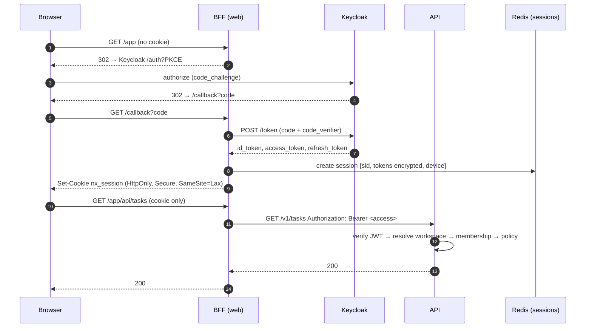

**Why.** Any token reachable from JavaScript is a token reachable from an XSS. A server-side session
means there is nothing to steal from the browser but an opaque cookie, logout is a server-side delete
rather than a client-side promise, and refresh tokens never exist outside the BFF. It also means the
browser cannot tamper with claims, because it never sees any.

**Cost.** Every page load reaches the BFF, so the BFF must be deployed close to the user and must not
become a bottleneck. It is stateless apart from the session lookup, and it scales horizontally.

### 6.3 Access token validation (API)

In order, and the request is rejected at the first failure:

1. Signature against Keycloak's JWKS — cached, refreshed on `kid` miss, never fetched per request.
2. `iss` equals the configured realm issuer; `aud` contains `nexora-api`.
3. `typ` is `Bearer`; `exp` and `nbf` valid within a 60-second clock skew.
4. `sid` present, and not in the revocation set (§6.7).
5. `sub` maps to an active user record (cached 60 s).
6. Only then is a tenant resolved (§6.5) and authorisation evaluated (§6.6).

Steps 1–4 are pure token validation and are the only steps the authentication middleware performs.
Step 5 is a lookup, not a trust decision. Step 6 is where every authorisation decision happens, and it
happens per request.

### 6.4 Refresh rotation and reuse detection

**[D-ARCH-26] Rotation with family revocation, not rotation alone.**

- Keycloak issues a new refresh token on every use; the previous one is invalidated.
- Presenting an already-used refresh token is treated as theft, not as an error: the entire session
  family is revoked, the user is signed out everywhere, and a `session.reuse_detected` audit event is
  emitted with the device, IP and time of both presentations.
- Refresh happens in the BFF, never in the browser, so a stolen cookie cannot be refreshed from a
  different device without also presenting the device binding.

**Why family revocation.** Rotation without reuse detection protects nothing: an attacker who steals
a refresh token simply races the legitimate user, and the loser sees a confusing error instead of a
security event. Detecting reuse converts a silent compromise into a loud one.

### 6.5 Workspace switching — and why `workspace_id` is not a claim

**This replaces the earlier design**, which put the active workspace in the access token. That design
had two problems: switching required re-issuing a token (so switching was a login-shaped operation),
and it implied the token was what enforced tenancy — which is exactly backwards. A claim is data the
client presents; tenancy must be a fact the server checks.

**[D-ARCH-27] The access token carries identity only. The requested workspace is resolved per request
against a membership row.**

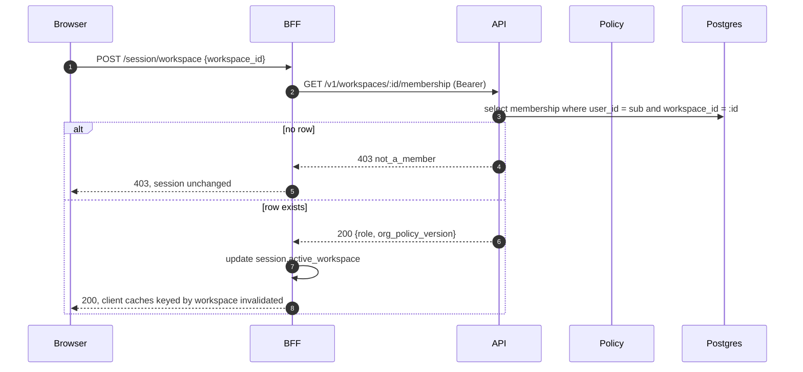

The request pipeline is fixed:

```
authenticate (token → sub, sid)
  → resolve workspace from X-Nexora-Workspace
  → membership lookup (sub, workspace_id)          ← tenancy boundary
  → policy.require(ctx, permission, resource)      ← authorisation
  → handler
  → SET LOCAL app.workspace_id = <verified id>     ← RLS, from the row, never the header
```

**What this buys.**

- Switching is a session update, not a token exchange. It is instant, and it cannot fail because of
  clock skew or a stale claim.
- Removing a member takes effect on the next request, because membership is read per request rather
  than baked into a 10-minute token.
- The RLS variable is set from the verified membership row, never from the header. A forged header
  produces a failed lookup, not a different tenant.
- Client-side claim tampering has nothing to tamper with: the only identity claim is `sub`, and
  changing it invalidates the signature.

**What it costs.** One indexed lookup per request, cached for 30 s per `(sub, workspace_id)` and
invalidated by a `membership.changed` event. That is a cache, not a source of truth.

### 6.6 Membership and authorisation checks

**[D-ARCH-08] Authorisation is a single policy call, evaluated in the API.**

```ts
await policy.require(ctx, 'workspace.member.invite', { workspaceId, resource });
```

- RBAC supplies the role bundle; ABAC adds conditions (resource owner, data classification, device
  posture, organisation policy).
- Default deny. Parent policy (organisation) can only tighten, never loosen, a child (workspace).
- The result carries a *reason*, so the UI can explain a disabled button instead of just disabling it
  — this is what the role matrix in the design is for.

**Why a central engine rather than guards per module.** The specification requires it (§8.2.5), and
the practical reason is auditability: one place to log "who was denied what, and why".

**Alternatives considered.** Casbin/OPA as an external PDP. Both are reasonable; the decision here is
to keep the first version in-process behind a port, so swapping in OPA later is an adapter, not a
rewrite. **[P]** If policy volume or organisational policy authoring grows, OPA becomes attractive.

**Hidden buttons are not a control.** §17.2 says so explicitly. Every UI affordance the matrix disables
is also denied server-side, and the two are generated from the same permission strings so they cannot
drift.

### 6.7 Session revocation

Three mechanisms, because they have different latency and different reach:

| Trigger | Mechanism | Effective within |
|---|---|---|
| User signs out | BFF deletes the session record; Keycloak `logout` for the `sid` | Immediate for that browser |
| Admin revokes a user's sessions | Keycloak admin API revokes the session family; API adds `sid` to the revocation set | ≤ 10 min (access token TTL), or immediate if backchannel logout is wired |
| Membership removed / role downgraded | `membership.changed` event evicts the per-request cache | ≤ 30 s |
| Password change, MFA reset, device removed | All sessions for the user revoked, except the current one when the change is self-service | Immediate |

The revocation set is a Redis key `revoked:sid:<sid>` with a TTL equal to the access token lifetime.
Nothing longer is needed: once the token expires, the signature check fails on its own.

**Why not check Keycloak on every request.** It would make the IdP a hard dependency of every API
call, and an IdP outage would become a product outage. The revocation set keeps the dependency off the
hot path while bounding the exposure to one token lifetime.

### 6.8 Step-up authentication

`acr` / `amr` freshness is required for: email change, MFA disable, passkey addition or removal,
payment method change, workspace deletion, ownership transfer, and approving an AI action classified
`destructive`. The requirement is expressed as a policy condition, not as a separate endpoint, so a
new sensitive operation cannot forget it.

### 6.9 What this costs

| Concern | Cost |
|---|---|
| BFF session store | One Redis write per login, one read per request, ~1 KB per session |
| Membership lookup | One indexed read per request, cached 30 s |
| Revocation set | One Redis read per request, only after signature validation succeeds |
| Keycloak | One additional deployable; managed or containerised |
| Operational | Key rotation, JWKS caching, clock-skew monitoring |

**Complexity.** Moderate. The hard part is not the check; it is the inventory of permissions and the
matrix behind them — which the design already renders as a reviewable grid.

---

## 7. Workspace and organisation hierarchy

**[S]** User → (many) Memberships → Workspace (Personal / Team / Organization) → Resources.
Organization owns policy; workspace owns collaboration, configuration and usage.

**[D-ARCH-09] Three levels, one active context, no silent switching.**

- A request always carries exactly one `workspace_id`, in `X-Nexora-Workspace`. There is no "all
  workspaces" query outside analytics.
- Switching workspace updates the server-side session (§6.5) and invalidates client caches keyed by
  the previous workspace. It does not re-issue a token, and it cannot be done by editing a claim,
  because the token carries no workspace. The UI already treats this as a hard context switch; the
  backend agrees by re-reading membership before the next request is served.
- The organisation is a scope a user can *select*, not only a container they inherit: billing,
  security reporting and policy are org-scope screens, and §6.5 resolves them through the same
  membership check against the org's own workspace row.
- Personal workspaces are never governed by an organisation policy. The specification is explicit,
  and it is the one place where "organisation can tighten" does not apply.

**Lifecycle** (from §16.4): `created → active → restricted → deletion_pending → deleted`.
`restricted` is the state that makes billing failures survivable: read access continues, writes and
AI calls stop, nothing is deleted.

**Ownership transfer** requires: step-up auth, a named successor who accepts, an audit event, and a
cooling-off window during which the previous owner can cancel. **[D]** The window is 72 hours by
default — long enough to catch an account takeover, short enough not to block a real handover.

---

## 8. Central AI and Personal AI: the provider abstraction

**[S]** Two independent routes; both go through the AI Gateway; Personal keys are server-side only,
envelope-encrypted; fallback only with explicit prior permission; fail-closed by default.

**[D-ARCH-10] One interface, two credentials, one metering path.**

```ts
interface ProviderAdapter {
  readonly id: string;                       // 'openai', 'anthropic', 'custom'
  capabilities(): ModelCapabilities;         // context, tools, vision, streaming
  chat(req: ChatRequest, signal: AbortSignal): AsyncIterable<ChatChunk>;
  embed?(req: EmbedRequest): Promise<EmbedResponse>;
  countTokens(text: string): number;         // best-effort, used for pre-flight budget
}
```

Adapters normalise: message shape, tool-call format, streaming deltas, usage accounting, error
taxonomy, and rate-limit headers. Nothing above the adapter may branch on provider name.

**Error taxonomy** — this is the part that decides what the user sees, so it is designed, not
inherited:

| Class | Example | Product behaviour |
|---|---|---|
| `auth` | 401 invalid key | fail-closed, point at connection settings |
| `rate_limit` | 429 + reset | wait or offer the other route; never silent retry loops |
| `timeout` | no first token in 45 s | cancel, no charge, offer retry |
| `context_overflow` | prompt too long | offer trimming, never truncate silently |
| `provider_down` | 5xx / circuit open | fail-closed unless fallback is explicitly allowed |
| `policy_blocked` | content policy | surface as-is, do not paraphrase |

These map one-to-one onto the five failure states now drawn in the prototype.

**[D-ARCH-11] Personal key lifecycle.**

```
create → encrypt (KMS data key per workspace) → store ciphertext + key id
       → test connection → active
       → rotate (new ciphertext, old key retired) → revoke (ciphertext destroyed)
```

- Envelope encryption: a per-workspace data key, wrapped by the KMS master key. Rotation rewraps the
  data key, so no re-encryption of stored content is needed — the specification asks for exactly this.
- The plaintext key exists only inside the Gateway process, only for the duration of a request.
- Logging filters drop any header matching `authorization`, `x-api-key`, `api-key` before the log
  line is constructed, not after.
- Base URL validation blocks loopback, link-local, private ranges, metadata endpoints; resolves DNS
  and re-checks the resolved IP to defeat rebinding; enforces an egress allowlist for custom hosts.

**[D-ARCH-12] Fallback is a state machine, not a boolean.**

```
Personal ──failure──► BLOCKED ──user consent──► Central (this session only)
                        │
                        └──workspace policy denies──► BLOCKED (no route)
```

Consent is per-session by default, and per-workspace only if the user explicitly says so. The
decision is written to the audit log with the reason, because "why did my private prompt reach the
platform provider" must always have an answer.

**Alternatives considered.** A single aggregated provider SDK (loses the ability to model failure
classes precisely); client-side key storage (unacceptable — the specification forbids it).

**Scalability.** The Gateway is the first candidate for extraction: it is the only component with
long-lived connections, external latency and per-provider circuit breakers.

**Complexity.** Moderate-high. It is the component where most of the product's trust is stored.

---

## 9. AI Gateway, tool permissions and the approval workflow

**[S]** No direct provider access from the frontend or an agent; tool calls are risk-classified;
write-sensitive and destructive actions require human approval; a model answer is never permission.

> **Corrected in this revision.** The earlier state machine used `proposed` and `denied`, which did not
> match the vocabulary used in the design, and it bound approval to "the agent version" without saying
> what happens when that version changes. Both are fixed below: the state names are now the eight the
> product uses end to end, and every binding is enumerated with the rule that voids it.

### 9.1 The gate is a record, not a dialog

The UI promise is *"no outbound request is sent until you approve."* That promise has to survive a
worker restart, a deploy, a retry, and a user who comes back the next morning. An approval held in
memory, in a session, or in a client-side flag cannot keep it. So the approval is a row, and the row
is the authority.

**[D-ARCH-13] The approval gate is a persisted state machine.**

### 9.2 What an approval is bound to

**[D-ARCH-28] An approval binds eleven facts. Ten of them are immutable; one changes only by
transition.**

| # | Bound fact | Column | Why it is bound |
|---|---|---|---|
| 1 | User identity | `approved_by` | The approver is an accountable human, not "an admin" |
| 2 | Tenant | `workspace_id`, `organization_id` | An approval in one tenant must never execute in another |
| 3 | Agent identity | `agent_id` | Two agents may share a tool name and mean different things |
| 4 | Agent version | `agent_version_id` | Editing instructions after approval changes what will run |
| 5 | Workflow version | `workflow_version_id` | Same, for the surrounding graph |
| 6 | Tool name | `tool_name`, `tool_version` | A tool that gains a parameter is not the same tool |
| 7 | Exact arguments | `argument_hash` | The whole point: approval is of *this* call |
| 8 | Approval policy version | `policy_version` | The rule that decided approval was needed can change |
| 9 | Expiry | `expires_at` | An approval is not a standing permission |
| 10 | Status | `state` | The only mutable field, and only by the transitions in §9.3 |
| 11 | Executor and time | `executed_by`, `executed_at` | Answers "who actually ran it", which is not always the approver |

```ts
// Canonical, order-independent, and stable across languages.
argument_hash = sha256(
  canonical_json({ tool: tool_name, version: tool_version, args: tool_args })
)
```

The hash is computed by the API when the approval is created, recomputed by the executor immediately
before the call, and compared. A mismatch is not a warning — it is a refusal, logged as
`approval.argument_mismatch`.

**Why a hash and not the arguments themselves.** The arguments may contain secrets (an API key
parameter, a customer record). Storing a hash lets execution prove "these are the approved arguments"
without the approval table becoming a copy of the data the approval was meant to protect. Where the
arguments must be shown to the approver, they are stored encrypted and separately from the hash.

### 9.3 The state machine

Eight states, named identically in the database, the API, the events and the UI. No synonyms.

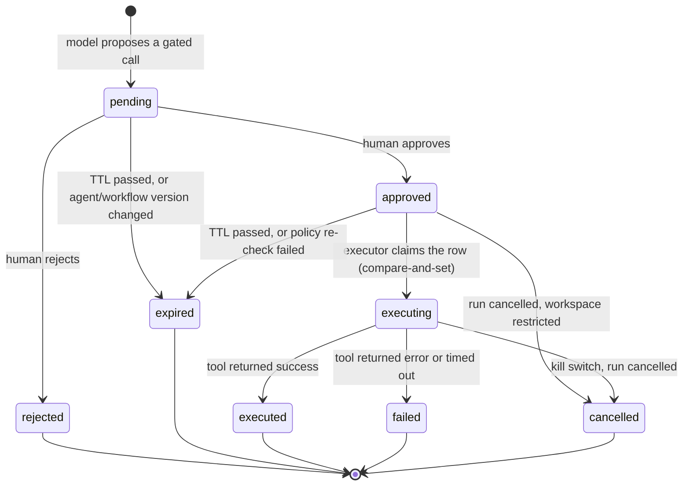

| State | Meaning | Terminal | Visible in UI as |
|---|---|---|---|
| `pending` | Waiting for a human. The only state the user can act on. | No | Approval card, saffron, `Pending approval` |
| `approved` | A human said yes; not yet claimed by an executor | No | `Approved, queued` |
| `rejected` | A human said no. The run continues without the tool or stops, per the agent's policy | Yes | `Rejected by <name>` |
| `expired` | TTL passed, or the thing being approved changed underneath it | Yes | `Expired — re-approval required` |
| `executing` | Claimed, in flight. Exactly one executor holds it | No | `Running` with the live dot |
| `executed` | Completed. `executed_by` and `executed_at` are set | Yes | `Done` with a link to the result |
| `failed` | Attempted and errored. Retry creates a **new** approval, never reuses this one | Yes | `Failed` with the error code |
| `cancelled` | Abandoned: kill switch, run cancelled, workspace restricted | Yes | `Cancelled` |

**Why `failed` does not go back to `approved`.** A retry is a new decision: the tool may now have
side effects from the first attempt, the arguments may need to change, and the user who approved may
no longer be the person entitled to approve. Reusing the row would let a flaky tool execute twice on
one human decision.

### 9.4 What invalidates an approval

| Change | Effect | Reason code |
|---|---|---|
| Arguments differ from `argument_hash` | Execution refuses | `argument_mismatch` |
| A new agent version is published | All `pending` and `approved` rows for the old version → `expired` | `superseded_agent_version` |
| A new workflow version is published | Same, for the workflow | `superseded_workflow_version` |
| The approving user loses the permission to approve | `approved` → `expired` at execution re-check | `approver_no_longer_entitled` |
| Organisation policy tightens | Execution re-evaluates against the current policy; a now-denied call → `expired` | `policy_changed` |
| Workspace enters `restricted` | `approved` → `cancelled` | `workspace_restricted` |
| TTL passed | `pending` or `approved` → `expired` | `ttl_expired` |
| Agent, tool or workflow is deleted | `pending`/`approved` → `expired` | `target_removed` |

**The rule behind the table.** If any fact in §9.2 changes, the approval stops being an approval of
the thing that will run. The safe response is always `expired` with a reason the user can read,
never a silent re-evaluation that executes something nobody approved.

**Re-approval is a new row, not a resurrection.** The old row keeps its terminal state, so the audit
trail shows both decisions and the reason the first one lapsed.

### 9.5 Replay and duplicate execution

**[D-ARCH-29] Three independent defences, because each one alone has a hole.**

1. **Compare-and-set claim.** The executor transitions `approved → executing` with
   `UPDATE ... WHERE id = $1 AND state = 'approved'`. A row count of 0 means somebody else claimed
   it; the executor backs off rather than retrying. This survives two workers racing on the same
   queue message.
2. **Single-use execution token.** The approval token the worker presents is signed by the API,
   carries `approval_id`, `run_id`, `argument_hash` and a `jti`, and expires in 5 minutes. The `jti`
   is recorded on first use; a second presentation is `approval.replayed` and the row goes to
   `failed`, not `executing`.
3. **Idempotency key at the tool boundary.** Every outbound call carries
   `Idempotency-Key = hash(approval_id)`. A retry after a network timeout that the provider actually
   processed returns the original result instead of performing the action twice.

**Why all three.** (1) protects against concurrency, (2) against replay of a captured token, (3)
against the failure that actually happens most often — a timeout where the call succeeded and the
response was lost. Any one of them alone leaves a real path to double execution.

### 9.6 Risk classification

Drives whether approval is required at all, and how much the card has to explain.

| Class | Examples | Gate | Card shows |
|---|---|---|---|
| `read_internal` | search workspace, read a file | policy only | nothing — no card |
| `read_external` | web search, fetch URL | policy + egress rules | destination domain |
| `write_internal` | create task, update a record | approval if scope > N records | what changes, how many |
| `write_external` | send email, post to a third party | always approval | recipient, payload preview |
| `destructive` | delete, revoke, transfer | approval + step-up | what is lost, reversibility, recovery window |

### 9.7 Tool execution is isolated

**[D-ARCH-14] Tool execution runs outside the API process.** Plugin and user-authored tools run in a
sandbox with no filesystem, no network except declared endpoints, a CPU/memory/time budget, and no
ambient credentials. The specification forbids running untrusted code in the API process; this is how
that is honoured without inventing a second runtime for the MVP — a container-per-invocation runner
with a warm pool.

The executor is the only component that holds a tool credential, and it holds it only for the
duration of one call, scoped to the declared endpoints of that tool.

### 9.8 Prompt-injection posture

Retrieved content and tool output enter the context tagged with a trust level and are never
concatenated into the system instruction. The model may *propose* an action; the Policy Engine decides
whether it is allowed, and the approval gate decides whether it happens. A model cannot widen its own
permissions because permissions are not expressed to it as data it can edit.

An instruction found inside a retrieved document is data. If it asks for a tool call, the call is
gated exactly as if the user had asked for it — which is why the approval card names the *tool and
arguments* rather than summarising the model's intent. The summary is the model's claim about what it
is doing; the arguments are what will actually run.

### 9.9 What the user sees

The card is generated from the approval row, not written by the model, so it cannot be talked out of
saying what will happen:

- **What** — tool name in plain language, and the one sentence the tool's own schema provides.
- **Where** — workspace, and the external destination when there is one.
- **What changes** — the affected resource count and the first few names.
- **Risk** — the class from §9.6, with the reason.
- **Reversible?** — and for destructive actions, the recovery window.
- **Exactly what is approved** — the canonical arguments, expandable, with the hash shown so a
  technical reviewer can verify that what they see is what will run.
- **Expiry** — when this decision lapses, because an approval without a deadline is a permission.

**Complexity.** High. This is the highest-risk area of the product and should be built by whoever owns
security, not by whoever is free.

---

## 10. API and webhook architecture

**[S]** REST with `/v1`, OpenAPI contract, OAuth 2.1/OIDC for apps, API keys for machines, HMAC-signed
webhooks with retry and replay protection, transactional outbox, standard event envelope.

**[D-ARCH-15] Contract-first, generated, and checked in CI.**

```
packages/contracts/openapi.yaml  →  server types (NestJS)  →  client SDK (TS)
                                 →  contract tests (both directions)
```

A breaking change fails CI unless it lands under a new major version. Additive changes are allowed
in minor versions. Deprecation requires a `Sunset` header and a published end-of-support date.

**Idempotency.** Every mutating endpoint accepts `Idempotency-Key`; the response is stored for 24
hours keyed by `(workspace, key)`. This is not a nicety — retries are guaranteed by the network.

**Webhooks.** Delivery is at-least-once, ordered only within an aggregate. Signature covers
`timestamp.body`; timestamps older than 5 minutes are rejected. Retries: 8 attempts over ~24 hours
with exponential backoff and jitter, then a dead-letter queue with manual redelivery from the
developer portal. A webhook that fails 100 consecutive times is disabled and the owner is notified.

**Event envelope** (§19): `event_id`, `event_type`, `occurred_at`, `workspace_id`, `actor_id`,
`correlation_id`, `schema_version`, `payload`. Consumers must be idempotent; the envelope carries
enough to make that possible.

**Alternatives considered.** GraphQL (premature; the SDK story and the partner-integration story
both favour REST+OpenAPI for v1); gRPC externally (no browser story).

---

## 11. Billing, usage metering and quotas

**[S]** Hybrid model; entitlements separate from billing; the usage ledger is the source of truth;
hard limits separate from soft alerts; append-only ledger with adjustment events.

**[D-ARCH-16] Meter first, bill later, and never estimate silently.**

```
provider response ──► usage_event (raw, immutable)
                        │
                        ├─► usage_ledger (append-only, priced)
                        ├─► quota counters (Redis, fast path)
                        └─► budget alarms (soft 80%, hard 100%)
```

- `usage_event` records provider, model, input/output tokens, computed cost, currency, user,
  workspace, agent/workflow, correlation id, and the price table version used.
- Corrections are new `adjustment` rows. Nothing is ever updated in place — an invoice must be
  reproducible from the ledger alone.
- Quota checks happen **before** the call, using a fast Redis counter; the authoritative number is
  the ledger. If the two disagree, the ledger wins and the counter is rebuilt.

**Why a price-table version.** Provider prices change. An invoice from March must remain explainable
in July, which is impossible if cost is computed from today's table.

**[P]** Prices, plan names, tax, currency and payment provider remain parameters. The architecture
only requires: an adapter per payment provider, idempotent webhook handling, and a reconciliation
job that compares the provider's settlement file with the ledger.

---

## 12. Files and knowledge

**[S]** Upload validation, malware scanning, versioning, per-workspace encryption, short-lived
download links, quarantine before AI ingestion.

**[D-ARCH-17] A file is not "uploaded" until it is scanned.**

```
request → presigned PUT → object in quarantine/ → scan (AV + type sniff)
   → clean: move to workspace/ prefix, emit file.clean
   → infected: keep in quarantine, emit file.infected, notify, never index
```

- Object keys are `ws/{workspace_id}/{file_id}/{version}`, so a bucket policy can be scoped by
  prefix and a cross-workspace read is structurally impossible.
- Downloads are signed URLs valid for 5 minutes, bound to the requesting user's session.
- Text extraction and embedding happen only after `file.clean`; the AI layer has no path to a
  quarantined object.

**[D-ARCH-18] Retrieval is permission-filtered before it is ranked.** The vector query carries
`workspace_id` and the caller's accessible-resource set; pgvector's `WHERE` clause runs before
similarity ordering. Ranking first and filtering later is how a search feature leaks the existence
of documents.

**Scaling note.** pgvector is right for the MVP (metadata and vectors live together, one transaction,
one backup). It stops being right somewhere around tens of millions of chunks; the port that hides
it means moving to a dedicated vector store is an adapter change, not a rewrite.

---

## 13. Security: encryption, audit and secrets

**[S]** TLS 1.2+ (prefer 1.3), encryption at rest, KMS with rotation, Argon2id, mandatory MFA for
administrative accounts, step-up for sensitive actions, immutable audit log, four data
classification levels, secrets never in environment files or logs.

**[D-ARCH-19] Three key classes, three lifetimes.**

| Key | Scope | Rotation | Storage |
|---|---|---|---|
| Master key | platform | yearly, or on incident | KMS/HSM |
| Workspace data key | one workspace | on demand, rewrap only | KMS-wrapped, in DB |
| Field key | provider credentials, tokens | per secret | derived, never stored |

**Audit.** One append-only table plus an export stream. Every row: actor, action, target, workspace,
result, reason, IP, user agent, request id, and a hash chain to the previous row for tamper evidence.
Audit writes happen in the same transaction as the change they describe, so there is no window where
an action exists without its record.

**Secrets.** Application secrets live in a secret manager and are injected at runtime. The build
fails if a file matching known credential patterns is committed; the CI runs a secret scanner on
every push, not only on the default branch.

**Threat model coverage** (§21.1): CSRF (double-submit + SameSite), XSS (CSP with nonces, no
`innerHTML` on user content), SSRF (egress allowlist + DNS re-check), SQL injection (parameterised
queries only), IDOR/BOLA (RLS + explicit ownership checks), replay (nonce/timestamp on webhooks and
signed URLs), brute force (per-account and per-IP limiters with progressive delay).

---

## 14. Background jobs and event processing

**[S]** Transactional outbox, idempotent consumers, BullMQ on Redis for the MVP.

**[D-ARCH-20] Outbox for correctness, Redis for throughput.**

```
tx: { business write + outbox row }  ──commit──►  relay ──► queue ──► handler
```

- The relay polls the outbox with `FOR UPDATE SKIP LOCKED`, publishes, marks sent. If publishing
  fails, the row stays; nothing is lost between commit and publish.
- Handlers are idempotent by `(event_id, handler)` in a processed-events table. At-least-once
  delivery is assumed everywhere.
- Retry policy per job class: transient errors exponential, permanent errors dead-letter immediately.
- Poison messages go to a DLQ with the original payload and the failure reason; the DLQ has an
  owner and an alert, because an unmonitored DLQ is just a quieter outage.

**Why Redis/BullMQ and not Kafka.** At MVP volume, a log-based broker is operational weight without
a matching benefit. The outbox means the *contract* is broker-agnostic; swapping the transport later
does not touch business code.

---

## 15. Observability, logging and monitoring

**[S]** OpenTelemetry, metrics/logs/traces, SLOs, sensitive data masked.

**[D-ARCH-21] Three signals, one correlation id, and a hard rule about PII.**

- **Traces**: every request and every job. Span attributes include `workspace_id`, `module`,
  `operation`, and for AI calls `provider`, `model`, `token counts` — never prompt text.
- **Metrics**: RED for HTTP, USE for infrastructure, plus product metrics (approvals pending,
  fallbacks taken, quota rejections).
- **Logs**: structured JSON, one line per event, with `request_id` and `correlation_id`.

**PII rule.** Prompts, responses, file contents, emails and names are never logged. The logging
layer redacts by key allowlist rather than blocklist — a new field is invisible until someone
deliberately adds it.

**Initial SLOs** (from §21.2, treated as design targets, not promises): 99.5% monthly availability
for the MVP core; p95 read API under 500 ms excluding provider time; error budget burn alerts at 2%
and 10%.

---

## 16. Backup, disaster recovery and deployment

**[S]** Automated, incremental, multi-version, immutable, multi-region; RPO ≤ 24 h and RTO ≤ 8 h at
MVP, tightening later; quarterly restore tests.

**[D-ARCH-22] Restore is a rehearsed procedure, not a hope.**

- Postgres: continuous WAL archiving + daily base backup; point-in-time recovery to any second in
  the retention window.
- Object storage: versioning + cross-region replication; delete markers protected.
- Backups are encrypted with a key that the production account cannot read — ransomware protection
  is mostly about credential separation.
- A monthly automated restore into a scratch environment, with a smoke test that asserts row counts
  and a known query result. A backup that has never been restored is a hypothesis.

**Deployment.** Container images, immutable tags, signed; IaC for every environment; blue/green for
the API with a migration gate that runs expand-then-contract (add column → backfill → switch reads →
drop), so no deploy requires downtime and no rollback requires a data restore.

---

## 17. Testing strategy and CI/CD

**[S]** Test pyramid; contract tests; security tests for IDOR, tenant escape, privilege escalation,
SSRF, prompt injection, secret leakage; Definition of Done in §22.2.

**[D-ARCH-23] The tests that must exist before the first customer, in priority order.**

| Test | Why it is non-negotiable |
|---|---|
| Tenant isolation (API + DB + cache + search + queue + storage) | A single escape ends the company |
| Authorisation matrix (role × capability × resource state) | The design publishes this matrix; the code must match it |
| Approval gate state machine | The product's central promise |
| Usage ledger reconciliation | Money must be reproducible |
| Contract tests (OpenAPI + events) | Prevents silent breakage of the SDK and webhooks |
| Restore drill | Proves the backup claim |

Coverage targets are a poor proxy; these six suites are the actual gate.

**CI pipeline:** lint → typecheck → unit → integration (with a real Postgres) → contract →
tenant-isolation suite → SAST → dependency and license scan → secret scan → container scan → SBOM →
sign → deploy to staging → smoke → promote. Main is protected; nothing merges on a red build.

---

## 18. Environments and configuration

| Environment | Data | Access | Purpose |
|---|---|---|---|
| local | seeded, synthetic | developer | fast loop |
| preview (per PR) | synthetic | team | review |
| staging | synthetic, production-shaped | team + QA | release candidate |
| production | real | break-glass only | customers |

**Configuration.** Typed, validated at boot, fail-fast. No environment variable is read outside the
config module. Feature flags gate every risky path and are removed after the rollout completes —
a flag that lives forever is a second codebase.

**Rule from §21.4:** non-production environments never contain real customer data. This is a
constraint on tooling (anonymised snapshots), not a policy on slides.

---

## 19. New decisions this document proposes

These are **[D]** — they need approval and are not implied by the specification.

| # | Decision | Reversible? |
|---|---|---|
| D-ARCH-01 | Four deployables (web/api/worker/scheduler) from one monorepo | yes, merge worker into api |
| D-ARCH-02 | Design system as a versioned package, tokens generated from Phase 01 | yes, costly |
| D-ARCH-03 | Module boundaries enforced by lint + CI, not convention | yes |
| D-ARCH-04 | `set local` tenant context + generated RLS policy per table | yes, but this is the safety net |
| D-ARCH-05 | UUIDv7 primary keys + separate human-facing references | no (migration is painful) |
| D-ARCH-06 | Deletion as a tracked job across every store | yes |
| D-ARCH-07 | Keycloak owns credentials, NEXORA owns permissions | yes, at cost |
| D-ARCH-08 | Single in-process policy engine behind a port (OPA later) | yes |
| D-ARCH-09 | One active workspace per request; switch is a hard context change | no |
| D-ARCH-10 | Provider adapter with a fixed error taxonomy | yes |
| D-ARCH-11 | Envelope encryption per workspace, rewrap-only rotation | no |
| D-ARCH-12 | Fallback as an explicit state machine with recorded consent | yes |
| D-ARCH-13 | Approval gate persisted with argument hash and policy snapshot | no |
| D-ARCH-14 | Sandboxed tool execution with a warm container pool | yes |
| D-ARCH-15 | Contract-first OpenAPI with generated SDK and CI break detection | yes |
| D-ARCH-16 | Append-only ledger with versioned price tables | no |
| D-ARCH-17 | Quarantine-before-index for every file | no |
| D-ARCH-18 | Permission filter before vector ranking | no |
| D-ARCH-19 | Three key classes with separate rotation | partly |
| D-ARCH-20 | Outbox for correctness, Redis for transport | yes (broker swap) |
| D-ARCH-21 | Allowlist-based log redaction | yes |
| D-ARCH-22 | Monthly automated restore drill with assertions | yes |
| D-ARCH-23 | Six mandatory test suites as the release gate | yes |
| D-ARCH-24 | Keycloak is the only issuer of identity tokens; the API mints none | no |
| D-ARCH-25 | BFF session store — the browser never holds a token | yes, costly |
| D-ARCH-26 | Refresh rotation with reuse detection and family revocation | yes |
| D-ARCH-27 | `workspace_id` is resolved per request from membership, not carried as a claim | no |
| D-ARCH-28 | Approval binds eleven facts, seven of them immutable | no |
| D-ARCH-29 | Three independent defences against duplicate execution | no |

## 20. What this document deliberately does not decide

- Cloud provider, region, and the residency map — **[P]**, contract and law dependent.
- Which AI providers ship at launch and at what price — **[P]**.
- Plan names, prices, tax, payment provider, marketplace commission — **[P]**.
- Whether the first release includes a free tier with AI — **[P]**.
- Exact SLO commitments and contractual RPO/RTO — **[P]**, must be validated against real
  infrastructure cost before being promised to a customer.
- Kubernetes: not now. The specification's position — containers first, orchestration when there is
  evidence — is the right one, and adopting it early would buy operational burden without benefit.

---

## 21. Suggested build order

1. **Skeleton that proves the boundaries.** Monorepo, CI, one module end-to-end (Workspace), RLS,
   tenant context, audit, outbox. Nothing else. This is the phase where the architecture is either
   real or decorative.
2. **Identity and membership.** Keycloak integration, invitations, role matrix, policy engine.
3. **AI Gateway with one provider.** Central AI only, usage ledger, quotas, the five failure states.
4. **Agent + approval gate.** One tool, full state machine, audit.
5. **Knowledge & Files.** Upload → quarantine → scan → index → retrieval with permission filtering.
6. **Billing and entitlements.** Plans, subscriptions, hard/soft limits.
7. **Public API and webhooks.** Contract-first, SDK, developer portal skeleton.
8. **Enterprise controls.** SSO, SCIM, BYOK, residency, dedicated deployment.

Each step ends with its security tests green. The order is chosen so that the riskiest promises —
tenant isolation, approval, money — are proven early, while they are still cheap to change.

---

## 22. Diagrams

The five views a new engineer needs before reading any code. They are drawn from the decisions above,
so a disagreement between a diagram and a section is a defect in one of them.

### 22.1 System context

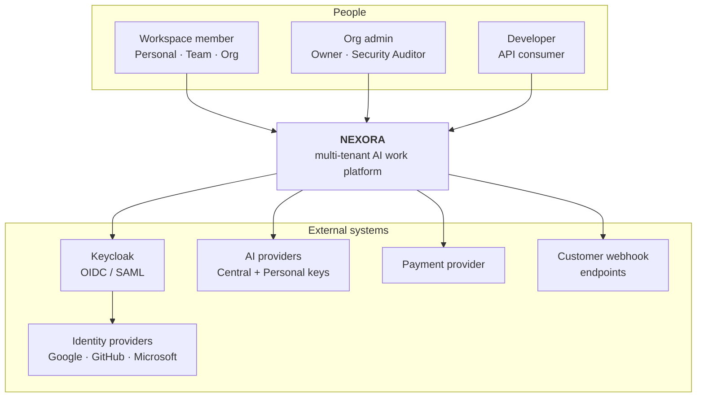

### 22.2 Containers

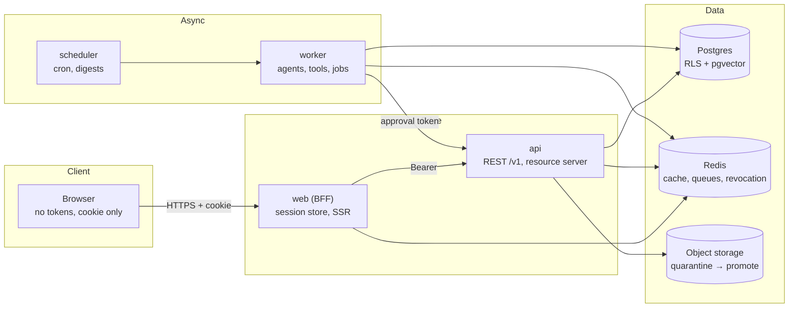

**Read the arrows as trust boundaries, not calls.** `web → api` crosses from "holds a cookie" to
"requires a bearer token"; `worker → api` crosses from "holds a signed approval token" to "verifies
it". Neither direction is allowed to carry an identity token (§6.1).

### 22.3 AI request lifecycle

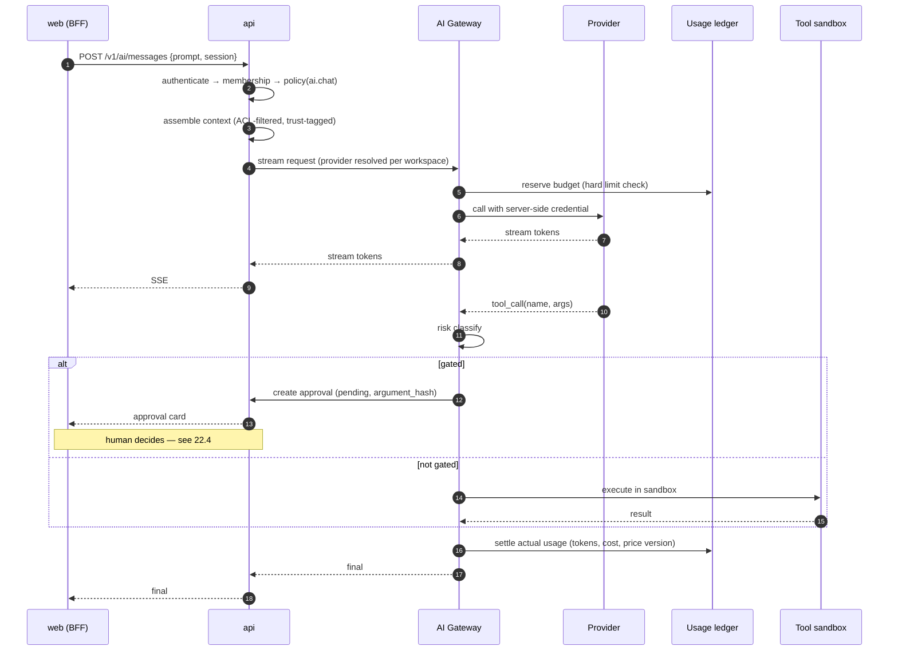

### 22.4 Approval and execution

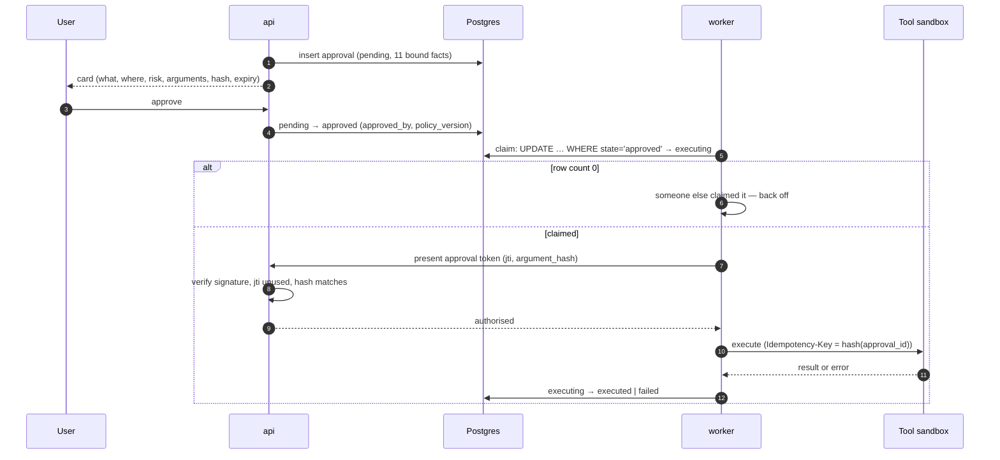

### 22.5 Tenant isolation

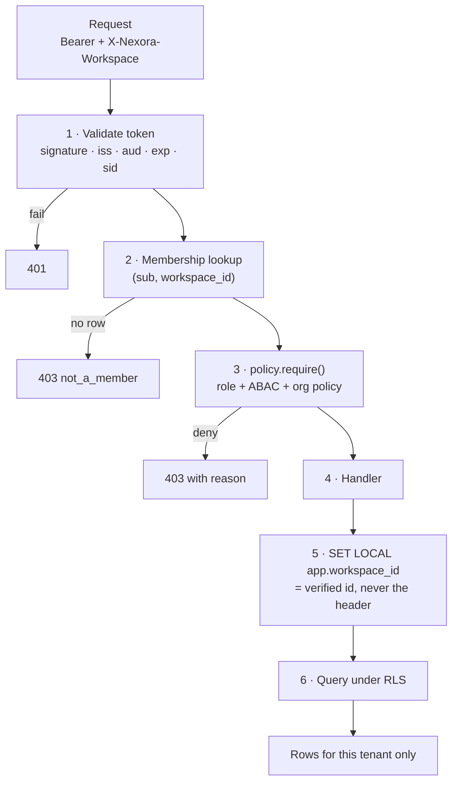

The header names a workspace. It never *proves* one. Steps 2 and 5 are the two places that decide,
and they read the same row.

### 22.6 Entity model (core)

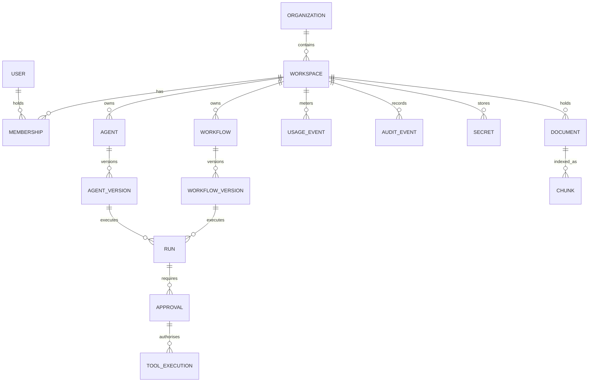

Every entity below `WORKSPACE` carries `workspace_id`. `USER` is the only global entity, and it is
reachable from a request only through a membership row.

### 22.7 Deployment

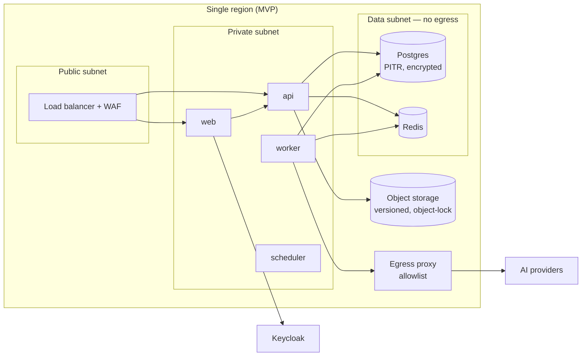

**The egress proxy is the residency control.** Application code never calls a provider directly; it
calls the proxy, which enforces the allowlist and the region. That is why residency can be asserted
by egress logs rather than by configuration review.

### 22.8 Observability

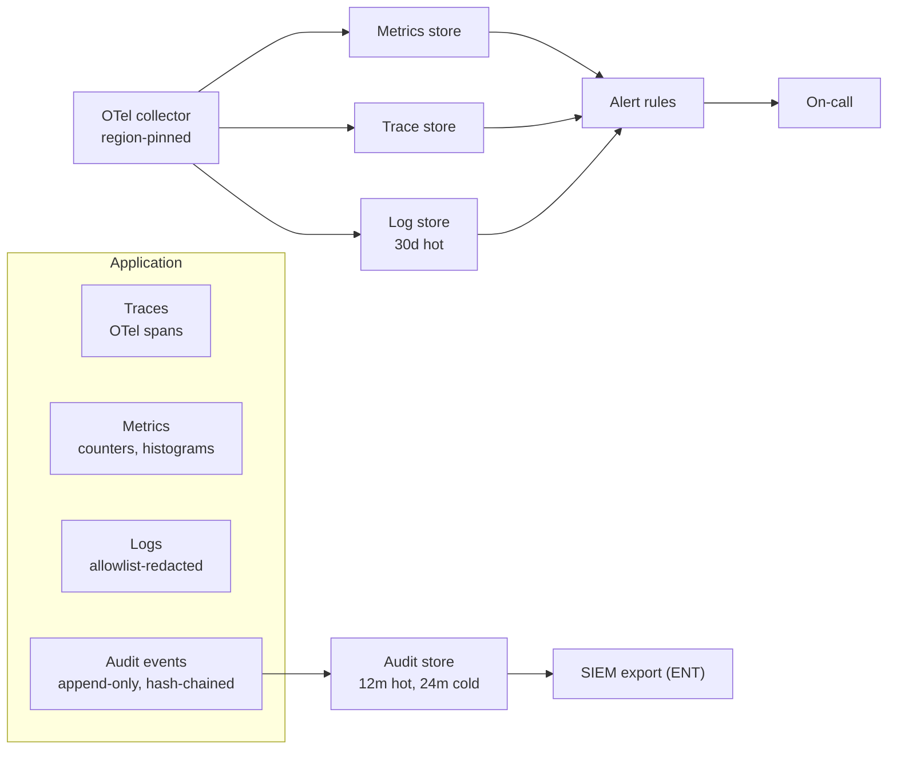

Audit is deliberately **not** in the log pipeline: logs are sampled and rotated, audit is neither.

---

## 23. MVP and post-MVP roadmap

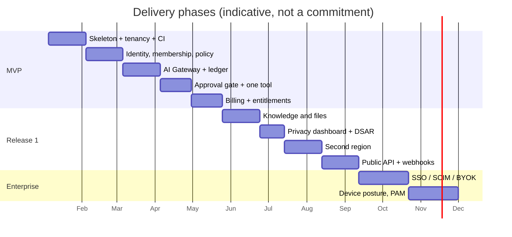

| Phase | Ships | Security gate |
|---|---|---|
| MVP | Tenancy, identity, AI with one provider, approval gate, billing | Domains 1,2,3,5,6,7,10,11,12,15,16 green |
| R1 | Knowledge, privacy dashboard, second region, public API | Domains 9,13,14,18 green |
| R2 | SIEM export, marketplace | Domain 4 green |
| ENT | SSO/SCIM, BYOK, device posture, residency guarantees | Domains 4,8,14,17,18 green |

**What must not slip.** Tenancy, the approval gate, and the usage ledger. Each is a decision that
becomes a migration if deferred: isolation cannot be retrofitted, an approval added later means
shipping a period where agents act unapproved, and a ledger that is not append-only from the first
row is a ledger nobody can audit.
